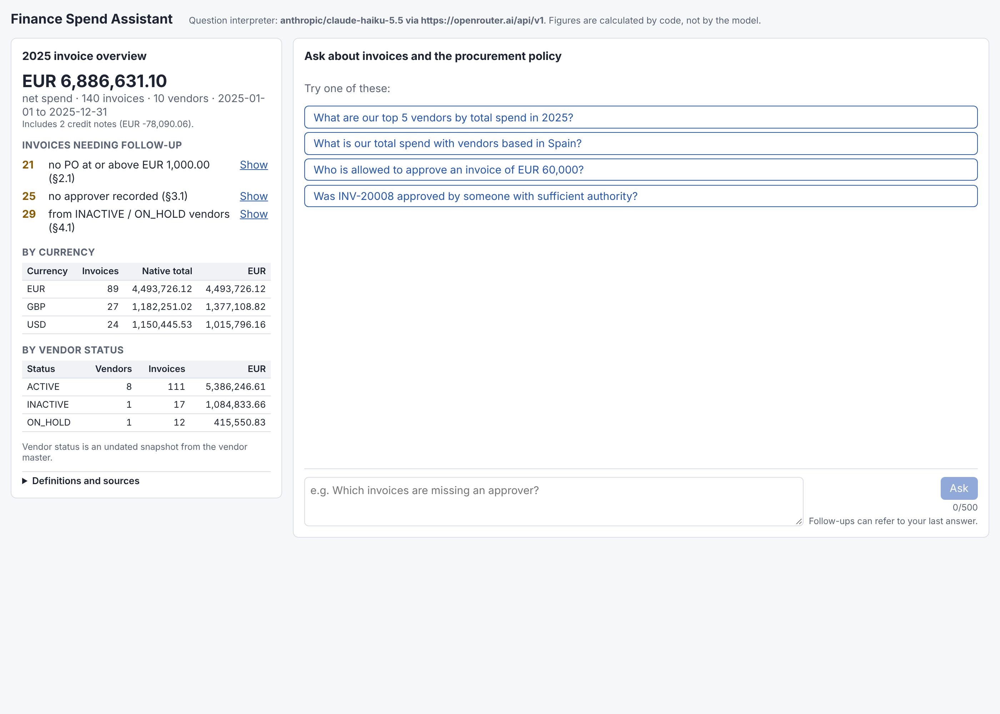
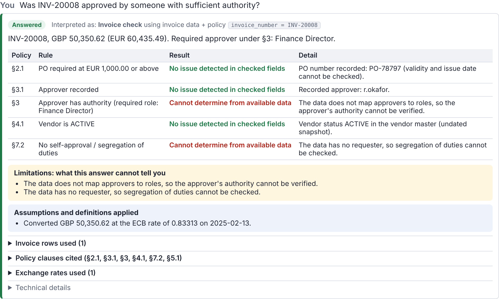
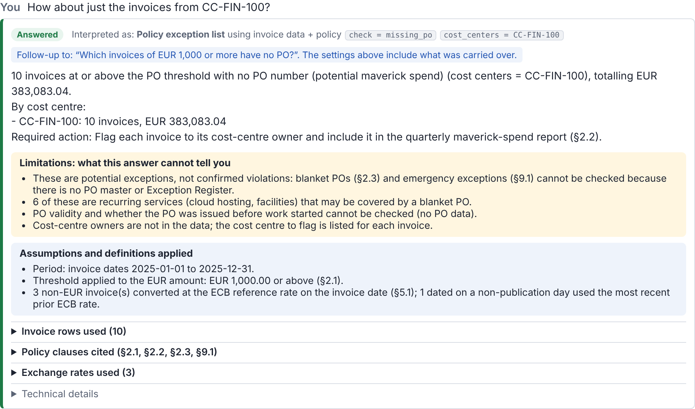
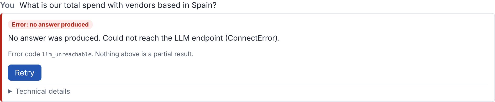

# Finance Spend Intelligence Assistant

A prototype that answers finance analysts' questions about 2025 invoices and the procurement policy (FIN-POL-014 v3.2). Every answer shows exactly what it is based on: the invoice rows, the policy clauses, the exchange rates, the assumptions it made and what it cannot tell you.

**Status:** prototype complete (backend, frontend, tests and evaluation).

**Stack:** FastAPI backend, React + TypeScript (Vite) frontend. The LLM runs through OpenRouter; the model is configurable.

**More detail:**
- [`docs/design.md`](docs/design.md): problem, data and policy analysis, evaluation design
- [`ai/LOG.md`](ai/LOG.md): how AI was used, my decisions, issues and fixes
- [`eval/results/`](eval/results/): every evaluation report
- [`eval/manual_review.md`](eval/manual_review.md): my manual test questions and results

## Write-up

### 1. What I built and what I left out

I focused on the Finance problem rather than building a general chatbot. The LLM interprets questions and selects tools, while calculations, conversion and policy checks are deterministic. An answer can sound correct but still be wrong if the data or evidence is incorrect. I prioritized core functions, evidence and evaluation. I left out authentication, databases, agent workflows and deployment due to the time limit.

### 2. How I evaluated it

For evaluation, I focused on three things: whether the LLM understands the question, whether the results and evidence are correct, and whether Finance users can understand the answers and limitations. I used independently calculated expected answers and tested ambiguity, missing information and failures. I ran 14 cases, 3 runs each, with 2 models, and no critical errors were reported. But this is still a small test set and doesn't prove production readiness.

### 3. What production would need

For production with 200 Finance users, I would consider role-based access control (since different users may have different permissions), real data integration, and audit trails under policy §8.2. I would also collect human-labeled examples to evaluate and improve performance. If policy documents become large and complex, I would consider RAG with a vector database. Production would also need policy versioning, data validation, CI/CD, and monitoring of latency, errors and costs. Before deployment, I would run a pilot with Finance users to check accuracy, missed exceptions and usability.

**Model API cost estimate (LLM calls only, not total production cost):** the measured median cost was USD 0.00064 per question with `anthropic/claude-haiku-5.5` and USD 0.00006 with `openai/gpt-6-luna` (run 8, as reported by OpenRouter). *Assuming* 200 users each ask 20 questions per working day over 21 working days a month, that is about 84,000 questions a month: roughly **USD 54/month with Haiku** or **USD 5/month with gpt-6-luna**. This excludes hosting, data integration, monitoring, support, and any increase in prompt size if the policy grows.

### 4. Optional enhancement: evaluation set and scoring script

For the optional enhancement, I chose the evaluation set and scoring script because I think measuring accuracy is more important than adding features at this stage. I wanted to check the full process, including tool selection, parameters, calculations and evidence, not just the final answer. I also tested ambiguity and failure cases to see if the assistant asks for clarification or stops instead of guessing. I used independently calculated answers rather than another LLM as a judge. The results are in [`eval/results/`](eval/results/). I didn't choose additional guardrails or agentic routing because the current design already limits the LLM to predefined tools and deterministic calculations. I wanted to evaluate this approach first.

## Time spent and next steps

- **Time spent:** about 4.5 hours, including planning, implementation and manual testing.
- **Next steps:**
  1. Policy-change and dirty-data cases in the evaluation (T14, T15, defined in design §3).
  2. A persistent audit log.
  3. Routing for questions that need several tools, shown explicitly to the user.
  4. Ingestion quarantine for bad data.
  5. More evaluation questions, collected from real analyst questions.

## Screenshots

| Start-up summary (no LLM) | Invoice check: evidence and limitations | Follow-up with one-turn context | LLM unavailable: fails closed |
|---|---|---|---|
|  |  |  |  |

## How it works

```
question ──► LLM interpreter ──► exactly one tool call ──► Pydantic + data-catalog validation
                (or stub)                                         │
                                                                  ▼
answer  ◄── fixed template ◄── deterministic tool (pandas, ECB FX, policy rules)
  + interpretation, evidence rows, policy clauses, FX rates, assumptions, limitations, versions
```

- **The LLM only interprets the question.** It picks one of 7 tools and fills in its parameters:

  | Tool | Used for |
  |---|---|
  | `spend` | Spend totals and breakdowns |
  | `exceptions` | Invoices missing a PO, missing an approver, or from a non-active vendor |
  | `approval_tier` | Who must approve an amount |
  | `invoice_check` | Checks on a single invoice |
  | `policy_clauses` | Quoting the policy |
  | `clarify` | Asking a clarification question |
  | `decline` | Saying the question can't be answered |

  It never calculates figures, picks invoice rows, or writes answer text. Invoice data is never sent to the LLM, so text inside the data (such as invoice descriptions) cannot inject instructions.
- **Every parameter is validated** against a JSON schema and against the values that actually exist in the data (countries, categories, vendor IDs, policy clause IDs). An invented value becomes an error, never a guess.
- **All calculations are deterministic code:**
  - Spend is the net invoiced amount in EUR, with credit notes and all statuses included.
  - Non-EUR amounts are converted at the official ECB rate for the invoice date. If none was published that day, the most recent earlier rate is used.
  - Approval tiers and the PO threshold are read from the policy document. If the document can't be parsed, the app won't start.
- **Answer text comes from fixed templates**, filled from the structured result. No second LLM call is made.
- **Failures fail closed.** An LLM timeout, a malformed tool call, invalid parameters or a missing FX rate all return `status: "error"`, with no result and no evidence. The UI says "no answer produced". Exactly one tool call per question is enforced by the API request (`parallel_tool_calls: false`).
- **Follow-ups use one previous turn, not chat history.**
  - The frontend sends the last *answered* question and its interpretation (tool and parameters) as optional `context`. The backend validates it with the same schemas.
  - The LLM sees it as a marked data block. If the new question builds on it ("How about just CC-FIN-100?"), the LLM reuses those settings, applies only the change, and sets a `follow_up` flag. The answer card then shows "Follow-up to: …", and the parameter chips show the full settings used.
  - A question that only makes sense as a follow-up but arrives without context is clarified, not guessed.

## Setup and run

Requirements: Python 3.11+ (tested on 3.13) and Node 20+ (tested on 22).

**Backend.** Create the virtual environment:

```bash
python3 -m venv backend/.venv
```

Install the dependencies:

```bash
backend/.venv/bin/pip install -r backend/requirements.txt
```

Create your local settings file:

```bash
cp .env.example .env
```

Edit `.env`: set `LLM_API_KEY`, or set `LLM_PROVIDER=stub` to run without an LLM. `.env` is git-ignored; never commit it. Then start the API:

```bash
cd backend && .venv/bin/uvicorn app.main:app --port 8000
```

**Frontend.** Install the dependencies:

```bash
cd frontend && npm install
```

Start the dev server:

```bash
cd frontend && npm run dev
```

Open http://localhost:5173. The dev server forwards `/api/*` to `http://localhost:8000`; set `VITE_BACKEND_URL` to point it elsewhere.

### LLM provider

The interpreter works with any **OpenAI-compatible `/chat/completions` endpoint that supports tool calling with `tool_choice: "required"`**. To switch provider, change these values in `.env`:

| Setting | Example |
|---|---|
| `LLM_BASE_URL` | `https://openrouter.ai/api/v1` |
| `LLM_API_KEY` | your key (sent as `Authorization: Bearer …`; left out when empty) |
| `LLM_MODEL` | `anthropic/claude-haiku-5.5` |

| Provider | Model | Status |
|---|---|---|
| OpenRouter | `anthropic/claude-haiku-5.5` (default) | **Tested:** full evaluation, 3 runs per case, 8 separate evaluation runs |
| OpenRouter | `openai/gpt-6-luna` | **Tested:** full evaluation, 3 runs per case, 6 separate evaluation runs |
| Stub (`LLM_PROVIDER=stub`) | keyword rules | Runs offline. Not an LLM; it fails some reworded questions. The UI header labels it "(not an LLM)" |
| OpenAI direct, Ollama, other OpenAI-compatible APIs | — | **Untested.** They should work if they support tools and `tool_choice: "required"` |

## API

- **`GET /health`:** which interpreter is in use, plus the data, policy and FX versions.
- **`GET /summary`:** works without the LLM. Returns net EUR spend, totals by currency and by vendor status, counts of invoices needing follow-up (no PO at or above the threshold, no approver, non-active vendor), and FX source information.
- **`POST /ask`** with `{"question": "...", "context": {"question": "...", "tool": "exceptions", "params": {"check": "missing_po"}}}`. `context` is optional: the previous answered turn, used for follow-ups. It always returns this shape:

```json
{
  "trace_id": "…", "status": "answered | clarification_needed | declined | error",
  "question": "…", "answer": "text from a fixed template", "result": { "…structured figures…" },
  "interpretation": { "tool": "spend", "route": "data", "params": { "countries": ["Spain"] },
                      "interpreter": "anthropic/claude-haiku-5.5 via https://openrouter.ai/api/v1",
                      "latency_ms": 900, "usage": { "prompt_tokens": 6124, "completion_tokens": 64, "cost": 0.0006 },
                      "follow_up_to": null },
  "evidence": { "rows": ["…invoice rows with EUR amount and FX rate used…"], "row_count": 49,
                "clauses": [{ "id": "5.1", "section": "…", "text": "…" }], "fx_rates": ["…"] },
  "assumptions": ["…"], "limitations": ["…"],
  "clarification": { "question": "…", "options": ["complete rewritten questions"] },
  "error": { "code": "llm_timeout", "message": "…" },
  "versions": { "data": "…", "policy": "FIN-POL-014 v3.2", "fx": "…" }
}
```

HTTP status codes:
- **200:** answered, clarification needed, or declined.
- **502:** the LLM failed or returned invalid parameters.
- **503:** an FX rate is missing.
- **422:** the request itself is invalid, including an invalid `context`.

## Frontend

- **Summary panel:** loads `/summary` on start-up, so figures are on screen before any question. It handles loading and error states and has a Retry button. Each "needs follow-up" count has a **Show** link that asks the matching question.
- **Answer card order:**
  1. The status badge and "Interpreted as: <tool> using <data/policy> + parameters".
  2. The answer: the key findings, plus a table of checks for invoice checks.
  3. **Limitations**, highlighted.
  4. Assumptions and definitions.
  5. Collapsible tables: invoice rows used, policy clauses cited (quoted word for word), exchange rates used.
  6. Technical details: model, latency, tokens, cost, the raw tool call, versions, trace ID.
- **Response states:**

  | State | What the UI shows |
  |---|---|
  | Loading | Spinner; the Ask button is disabled |
  | Answered | The full answer card above |
  | Clarification needed | Option buttons; each is a complete question sent as a new `/ask`. If there are no options (e.g. a missing date), an "Edit my question" button |
  | Declined | The reason |
  | Error | Error code, "nothing above is a partial result", Retry |
  | Network failure or timeout | Error message and Retry |

- **Follow-ups:** each question sends the last answered turn as `context`; no chat history is kept or sent. Clarification still works without it, as described above. State is plain `useState`.

## Tests and evaluation

| What | Command | Result (2026-11-05) |
|---|---|---|
| Backend unit and API tests (no network) | `cd backend && .venv/bin/python -m pytest -q` | **78 passed** |
| Evaluation (uses the LLM in `.env`) | `backend/.venv/bin/python eval/run_eval.py --runs 3` | See below |
| UI smoke test against the running app (optional; needs Playwright) | `cd frontend && node e2e/ui_smoke.mjs` | **28/28 checks passed**, including a follow-up (real backend; LLM-down case used a backend pointed at an unreachable LLM endpoint) |
| Frontend type check and build | `cd frontend && npm run build` | Passes |

**How the evaluation works** (design §3):
- Expected answers are computed independently in `eval/oracle.py`, with plain pandas and no app code.
- It tests three levels: the tools alone (no LLM), the LLM's interpretation, and the full answer end to end.
- Each case runs 3 times and the worst run counts.
- Clarification options are re-asked to check they get answered correctly.
- Failures are injected: timeout, malformed tool call, invalid parameters.
- Follow-up cases send the earlier question first and pass the last answered turn as context, as the frontend does. T18 checks that a self-contained question does not inherit filters; T19 checks that a follow-up sent without context is clarified.

**Results, last run after a code change (run 8):** 14 cases (T1–T6, T8, T11, rewordings of T1, T3 and T5, and follow-ups T17–T19) and 3 injected failures.

| Model (OpenRouter) | Critical errors | Cases with no findings | Tools level | Failure injection | Median latency | Median tokens per question | Median cost per question |
|---|---|---|---|---|---|---|---|
| `anthropic/claude-haiku-5.5` | 0 | 14/14 | 8/8 | 3/3 | 933 ms | 6,124 + 64 | USD 0.00064 |
| `openai/gpt-6-luna` | 0 | 14/14 | 8/8 | 3/3 | 1,212 ms | 3,330 + 31 | USD 0.00006 |

**History, kept in full in [`eval/results/README.md`](eval/results/README.md):**
- **Run 1** flagged 4 "major" consistency findings. These were a **checker issue**: the check compared LLM-written wording rather than meaning. After the fix, run 2 and run 3 are clean.
- **Manual testing found a bug the evaluation had missed:** for "top 5 vendors", the notes (non-active invoices, credit notes, converted invoices) described all 140 invoices instead of the 85 invoices of the vendors shown. The figures were correct. A new check that notes must match the evidence rows reported critical errors in T1 and T1-v on the unfixed code (run 4). After the fix, run 5 is clean. Runs 1–3 did not include this check.
- **Manual testing found a second bug the evaluation had missed:** a follow-up ("How about just the invoices from CC-FIN-100?") was interpreted without the previous question and returned all CC-FIN-100 spend instead of the 10 missing-PO invoices. On the unfixed code, the new two-turn case T17 failed for both models (run 6). After adding one-turn context, the first attempt (run 7) fixed T17 but caused Haiku to make two tool calls (T4) and invent tool names (T19). Enforcing a single tool call and simplifying the prompt fixed both. Run 8 is clean.
- **Verification re-run (run 9, no code changes):** Haiku was again 14/14 with 0 critical. gpt-6-luna had 0 critical but one major finding (13/14): in T5, one rewritten clarification option, asked again, led to a second clarification instead of an answer. This shows run-to-run variation.
- [Manual review](eval/manual_review.md) with Haiku: 19 questions; both bugs above were found this way.
- A stub dry run showed the scorer does catch failures. It also found a real defect: a figure appeared in the answer text but not in the result. That defect was fixed.
- **Caveat:** 11 questions over 140 invoices is a smoke test and a regression guard. It does not prove accuracy.

## Data

`data/` holds the provided pack. `data/fx/ecb_exr_2025.csv` contains the official ECB EUR/USD and EUR/GBP reference rates for 2025, unmodified; [`data/fx/SOURCE.md`](data/fx/SOURCE.md) records the request URL and download time. Rates were downloaded, never generated.
